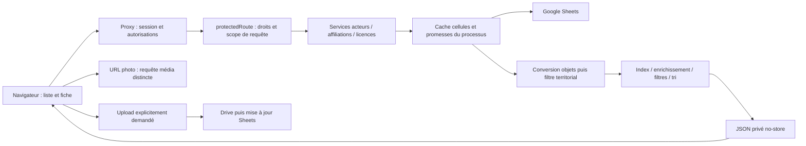

# Parcours affiliation et architecture

Référence : `dc467a6`, audit du 19 octobre 2026 Europe/Paris. Sauf indication différente, les constats ci-dessous sont **[Confirmés dans le code]** ; leurs fréquences réelles ne sont pas mesurées.

Sources : [proxy](../../proxy.ts), [guard](../../lib/auth/guard.ts), [scope-source](../../lib/auth/scope-source.ts), [data-context](../../lib/auth/data-context.ts), [Sheets](../../lib/google-sheets.ts). Le proxy et le guard peuvent vérifier la session dans des contextes distincts ; ne pas supposer un cache mémoire commun entre eux. `getSessionUser` dans le handler réutilise le snapshot du guard via AsyncLocalStorage.

## Séquence détaillée

| Étape / déclencheur | Route et méthode | Nécessaire / réellement chargé et traitements | Cache, fréquence statique et accès |
|---|---|---|---|
| Ouverture liste | GET `/api/athletes?view=table` | tableau et saison ; cellules ATHLETES entières, normalisation/tri de tous les acteurs autorisés, CATEGORIES_AGE, SAISON/PARAMETRES_SYSTEME frais, licences de saison en une lecture, index et catégorie par acteur, projection terminale 13 champs + clé optionnelle | effet au montage et revision ; no-store HTTP ; cellules cache processus ; guard/scope avant normalisation. 6,41 Mo historique fédéral, pas nouvelle capture |
| Recherche/filtres/pagination | aucune requête applicative dédiée | `DataTable` filtre les clés recherchables (`licenceDisplay`, nom, sexe, naissance, IDs, statut), applique filtres et slice local ; sexe/statut, pageSize 10 par défaut | scan local de la liste à chaque rendu ; état useState, aucune persistance explicite URL/sessionStorage. Aucun debounce réseau nécessaire pour cette recherche locale |
| Tri | aucune requête dédiée du tableau | copie/tri useMemo par nom ou numéro licence ; le serveur supporte aussi sort=licence mais le tableau ne l'appelle pas | nom client utilise encore localeCompare avec options ; le Collator publié concerne le serveur. Mesurer avant correction séparée |
| Ouverture fiche | GET `/api/athletes?id=…` | Sheets entière peut être convertie/scopée ; seuls matchs sont normalisés/enrichis, doublons conservés dans ordre stable ; catégories chargées, pas de settings/licences de saison sur ce chemin | effet sur athleteId ; getSessionUser/guard ; réponse complète même avec view=table ; ID inconnu/non autorisé peut produire tableau vide |
| Dès obtention de athlete | GET `/api/athlete-licences?athleteId=…` | seule histoire attendue ; `listAthleteLicences` charge 10 feuilles, construit tous index, mappe licences avant filtrage ; construit teams, summary et teamSummary même si la route ne renvoie que licences | effet dépend de **l'objet athlete**, pas du seul id ni de l'onglet actif ; remplacement après édition/photo peut relancer. Accès par guard + allowed(scope) et filtrage Sheets |
| Ouverture onglet Affiliations | GET `/api/affiliations/athlete?actorId=…`, GET `/api/auth/me`, GET `/api/affiliations/referentiels` | histoire individuelle + rôle ; référentiels génériques incluent teams/clubs/statuses/functions/types/entities de toutes familles. `listAffiliations` : 7 lectures logiques en deux vagues, index acteurs et structures complets, enrichissement N affiliations **avant** actorId | Radix sans forceMount : panel monté à l'activation (source installée 1.1.13 inspectée). À la sortie, démontage après éventuelle animation ; remontage susceptible de relire. Comportement navigateur non vérifié |
| Changement vers onglet Licence | pas de nouvelle requête causée directement par cet onglet | licences déjà chargées par effet parent | ne pas confondre ce chargement anticipé et le montage à la demande des affiliations |
| Ouvrir Ajouter/Modifier/Consulter affiliation | aucune requête explicite dans `start` | values recopiées/initialisées ; SearchSelect recherche localement parmi refs. Athlète utilise teams/statuses, pas toutes les entités officielles | refs préchargés au montage ; bouton d'ajout/modification masqué si non fédéral ; cela ne remplace pas contrôle serveur |
| Soumettre création/modification | POST `/api/affiliations/athlete` ou PUT `/api/affiliations/athlete/[id]` | prélecture affiliations fresh ; vérifications acteur/statut/équipe ; duplicate exact / chevauchement ; génération ID ; écriture puis confirmation enrichie | anti-double-submit ref côté client ; guard origine/WRITE/fédéral, audit avant/après. Idempotence exact create existe ; pas de test métier en production ici |
| Écriture et confirmation | appels internes Sheets, pas de GET client après succès | `writeSheetRowByHeaders` relit la feuille via API Google directe, repère ID/colonnes, values.update, invalide toutes plages de la feuille locale ; `listAffiliations` relit et enrichit toute la population avant sélection de la ligne confirmée | fresh n'évite pas la coalescence avec une lecture simple en cours. Invalidation locale n'annule pas pending. Gain P1 aussi sur cette confirmation ; ne pas supprimer confirmation |
| Succès affiché | aucune requête GET explicite | items remplacé/ajouté depuis json.affiliation, tri date décroissant ; formulaire fermé/toast | autres sessions et instances ne reçoivent pas d'événement affiliation ; focus/remontage/TTL permettent actualisation ultérieure |
| Focus / retour visibilité dans panel | GET affiliations | même histoire ; refs/auth ne sont pas rechargés par ce callback | deux listeners distincts sans coalescence client ; un clic navigateur peut ne pas produire les deux, à observer |
| Retour liste / athlète suivant | router.back puis Link vers fiche suivante | si remontage, GET table entier ; si composant restauré, état peut subsister. Focus, visibilité et messages saison changent revision | aucune restauration applicative explicite recherche/page/scroll ; état React pourrait être restauré par Next/navigation. Nombre réel de GET à vérifier ; la liste n'est pas rechargée explicitement par submit affiliation |

Sources : [liste](../../app/dashboard/athletes/page.tsx), [table](../../components/dashboard/data-table.tsx), [fiche](../../app/dashboard/athletes/[id]/page.tsx), [panel](../../components/dashboard/affiliations-panel.tsx), [service](../../lib/affiliations.ts), [écriture](../../app/api/_affiliation-write.ts), [référentiels](../../app/api/affiliations/referentiels/route.ts), [licences individuelles](../../app/api/athlete-licences/route.ts), [service licences](../../lib/licences.ts).

### Écart local P1, non publié

La séquence ci-dessus conserve l'état **publié dc467a6**. Dans la branche `perf/affiliations-filter-before-enrichment`, un `actorId` non vide filtre désormais les lignes déjà autorisées, juste avant le map d'enrichissement. La valeur comparée est strictement `clean(row[config.actor])`, déjà utilisée pour construire `item.actorId` : aucun changement de casse, de trim du critère ou de vérité du critère. Les index et toutes les lectures restent exécutés, même sans résultat ; les erreurs source restent donc observables. Sans actorId, le map conserve la même population. Tous les filtres finaux restent inchangés, y compris les filtres dérivés et le garde-fou actorId.

`mutateAffiliation` n'est pas modifiée : sa création idempotente et sa confirmation après écriture appellent déjà `listAffiliations(kind, { actorId })` et bénéficient ainsi du même filtrage. La génération d'ID, les validations, conflits, contrôles de relation, lecture fresh, écriture, confirmation et erreurs ne changent pas. Pas de raccourci qui accepterait une écriture sans relecture.

Une lecture logique n'est pas un appel réseau Google : microbatch, cache cellules, promesses partagées et retries changent ce nombre. Pour ligue/entente, le guard charge en plus structure (4 feuilles) et affiliations (4 feuilles) pour construire le scope ; fédéral retourne null sans ces lectures. Cet index de scope est reconstruit par requête, même si les cellules sont chaudes. Aucun index de scope persistant trouvé.

## Licences et autres usages

### Écart local P2 depuis la production 42f6db2

La séquence initiale ci-dessus reste une observation du code dc467a6. Dans `perf/athlete-licences-on-demand`, le GET de l'historique vient d'un composant enfant monté à l'activation de l'onglet Licence, et non plus de l'objet `athlete` du parent. Chaque remontage relit l'API ; une édition/photo avec même ID ne relance pas ce GET. Pas de restauration de liste, changement d'URL ou nouveau cache client.

La route individuelle conserve son garde et son enveloppe. Le service dédié garde les dix lectures et index, sélectionne les lignes par ID avant les vues puis conserve les contrôles territoriaux dérivés de l'affiliation. La liste globale utilise le même calcul de vues et continue à produire ses synthèses/références. Les mutations ne changent pas. La lecture/conversion/scoping Sheets complets peuvent rester nécessaires. Les tests locaux ne mesurent ni le trafic réel navigateur ni le CPU Vercel de ce correctif non publié.

- **[Confirmé dans le code]** `/dashboard/licences` commence par `/api/licences`, choisit seasonId depuis references, puis l'effet seasonId appelle `/api/licences?saison=…`. Deux chargements applicatifs possibles selon données de saison, différents d'un doublon attribué à Strict Mode. Recherche/filtres territoriaux sont locaux ; changement saison recharge.
- **[Confirmé dans le code]** `LicenceEditor` reçoit les références de la page ; ouverture seule sans équipe n'appelle pas l'éligibilité. Choix saison/équipe : GET `/api/licences/eligibilite?mode=EQUIPE&id_saison=…&id_equipe=…`. Recherche candidats locale. Le service parcourt les licences pour chaque candidat (find puis filter/sort), y compris le numéro précédent. POST `/api/licences/renouveler` ou PUT `/api/licences/[id]`, puis `onSaved → load(seasonId)` ; cohérence et écriture par lot serveur à préserver.
- **[Confirmé dans le code]** Autres familles : `actorLicenceIndex` est calculé une fois par GET liste mais reconstruit à chaque appel ; `listActorLicenses` charge licences, références et les quatre populations d'acteurs avant filtre. Les fiches récemment harmonisées utilisent `ActorLicenseHistoryTable`, sans bouton supplémentaire. L'ancien `ActorLicensesPanel` existe encore : suppression de code non utilisé à étudier séparément, sans élargir cet audit.
- **[Confirmé dans le code]** Dashboard : sept groupes batch métier, normalisations/jointures par requête, pas de cache résultat. Qualité des données a été retirée à `dc467a6`. Compétitions, équipes nationales et documents reconstruisent aussi des index/vues ; présence statique ne prouve pas qu'ils dominent le CPU actuel.
- **[Hypothèse]** Photos externes, chargement de composants/RSC et contrôles de navigation peuvent ajouter du trafic. Les photos sont des requêtes média distinctes ; la simple consultation ne téléverse pas Drive. Leur nombre, poids et cache dépendent des URL/en-têtes réels, non relevés sans session.

## Déclencheurs à ne pas confondre

`Link` a son prefetch par défaut. Le préchargement RSC d'une fiche ne démontre pas l'exécution de ses useEffect client ni un GET métier facturé. La documentation [Link](https://nextjs.org/docs/app/api-reference/components/link) précise le préchargement ; la page actuelle de doc est plus récente que Next 16.2.0 : ne pas lui attribuer ses nouvelles options. [React useEffect](https://react.dev/reference/react/useEffect) réserve le cycle supplémentaire de Strict Mode au développement. [Radix Tabs](https://www.radix-ui.com/primitives/docs/components/tabs) distingue forceMount ; le code du package installé confirme `present: forceMount || isSelected` et le montage conditionnel des enfants.

Google peut retenter une lecture dans la même requête : `google-request.ts` a par défaut deux retries, timeout 10 s, concurrence lectures 3/écritures 1, délais jitter bornés. Ce n'est pas un second GET navigateur. Les logs debug sont conditionnels, pas activés ici. Aucun retry HTTP automatique du parcours principal identifié ; les boutons Réessayer sont explicites. Les logs middleware/fonction d'un même requestId ne sont pas autant de consultations utilisateur.
